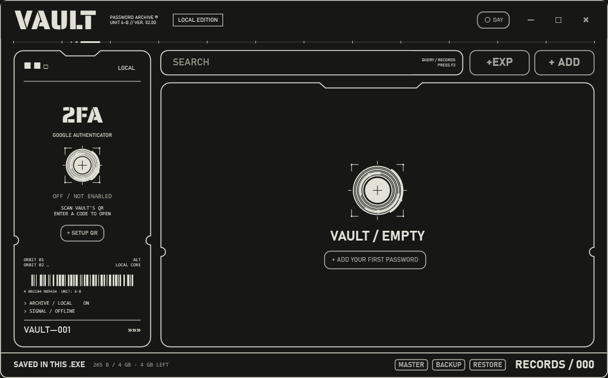

# Password Vault

A portable Windows password vault built with C# and WPF, with a monochrome day/night interface. 

Account data is saved inside the executable.



## License

Source-available for personal, noncommercial use only under [LICENSE.md](LICENSE.md). Commercial use, resale, redistribution, and sharing modified versions require Kimikozi's written permission, subject to the exceptions in that license. This is not an open-source license. Third-party components retain their own licenses.

## Features

- Separate username, email, password and recovery-detail fields.
- Password generation, search, clipboard copying and automatic clipboard clearing.
- Account QR codes with PNG export and QR image import.
- Bulk text import and export, encrypted backup and restore.
- Optional master-password encryption and offline Google Authenticator verification.
- Offline recovery codes for the authenticator check.

## Build

Requires Windows and the .NET 10 SDK.

```powershell
dotnet publish VelvetVault -c Release -r win-x64 --self-contained true -p:PublishSingleFile=true -p:IncludeNativeLibrariesForSelfExtract=true -p:EnableCompressionInSingleFile=true -o App
```

Run `App/VelvetVault.exe` from a writable folder. Keep your populated executable private: it contains your saved vault. The application imposes a 4 GiB total-file limit; this is an application limit, not a guarantee about executable formats.

## Data protection

Enable a strong master password with **MASTER** to protect your account data. Master-password mode derives encryption and authentication keys with Argon2id (64 MiB memory, three iterations, parallelism two) and uses AES-256-CBC with HMAC-SHA256 authentication.

Master-password protection is optional and off by default. Without it, the encryption key is stored with the vault and does not protect against someone inspecting the executable. The authenticator screen is an application access check, not a separate cryptographic encryption factor. Source code or executable modification can bypass that check.

Authenticator recovery codes cannot recover a forgotten master password. Keep your password safely. Backups retain the password and recovery-code state they had when created. Old backups may therefore restore previously used recovery codes.

Text exports, account QR images and optional master-password text files contain plaintext secrets. Keep them private. This personal project has not undergone an independent security audit.

## Optional sounds

Third-party game sound clips are not distributed here. To supply your own audio, place files you have permission to use at `VelvetVault/Sounds/open.mp3` and `VelvetVault/Sounds/close.mp3` before building. Triple-click **LOCAL** to toggle sounds for the session; they start off.

## Checks

```powershell
dotnet build Checks -c Release
dotnet run --project Checks -c Release -- --master-check
dotnet run --project Checks -c Release -- --recovery-check
dotnet run --project Checks -c Release -- --totp-check
dotnet run --project Checks -c Release -- --transfers
```

The full check runner expects a published executable in `App` and creates temporary synthetic vaults and preview files. Run it from the repository root.

## Third-party components

Uses QRCoder, ZXing.Net and Konscious.Security.Cryptography.Argon2 under their respective licenses. The bundled Saira Stencil font is distributed under the SIL Open Font License; see `VelvetVault/Fonts/OFL.txt`.

